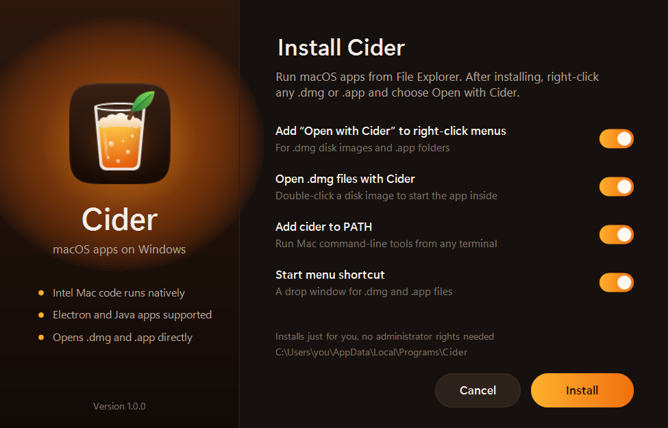
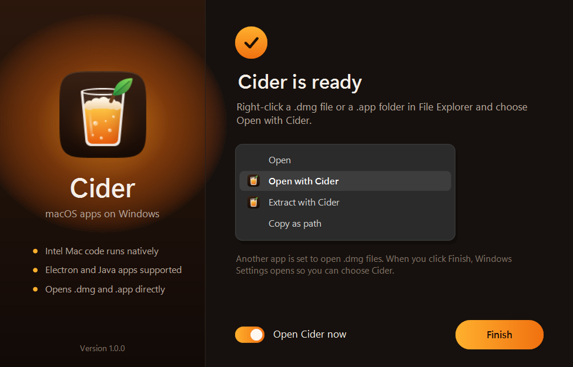
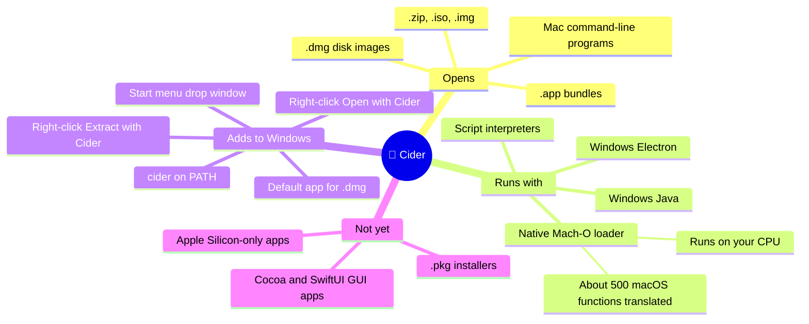
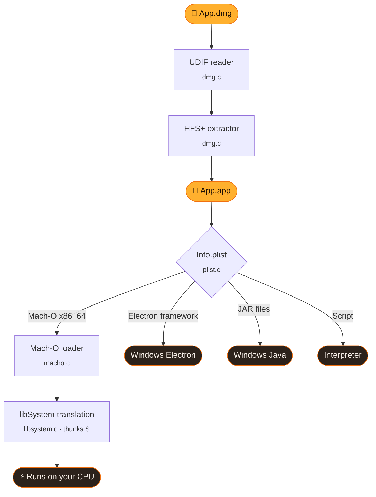
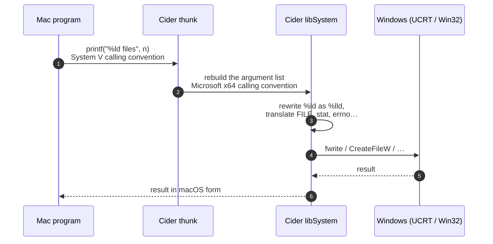

<div align="center">


# Cider

**Run macOS apps on Windows.**<br>
Right-click a `.dmg` or `.app` and choose **Open with Cider**.

[](#-install)
[](#-what-runs-today)
[](#-building-from-source)
[](LICENSE)

[Install](#-install) ·
[What runs](#-what-runs-today) ·
[How it works](#-how-it-works) ·
[Command line](#-command-line) ·
[Build](#-building-from-source) ·
[Credits](#-credits)

<br>




</div>

<br>

> [!NOTE]
> Cider is a **compatibility layer**, in the spirit of Wine. It isn't an emulator or a virtual machine:
> Intel Mac code is loaded straight into a Windows process and runs directly on your CPU, at native speed.
> The calls an app makes into macOS's system library are translated to their Windows equivalents as they happen.

## 🗺️ Cider at a glance



## ✅ What runs today

Please read this before you try it: **most graphical Mac apps don't run yet.** Apps built on Cocoa, AppKit or
SwiftUI (Apple's native UI frameworks) need re-implementations of hundreds of Apple frameworks. That is years of
work: the Darling project has been at it for a decade. When an app needs something Cider can't provide, Cider
says so plainly instead of crashing.

| | Kind of app | Status | How Cider runs it |
|:-:|---|:-:|---|
|  | Intel (x86_64) and universal **command-line programs** | ✅ Native speed | Cider's own Mach-O loader plus about 500 translated libSystem functions |
|  | **Electron apps** (many chat, note-taking and developer apps) | ✅ Runs | The app's JavaScript and resources run on the matching **Windows** build of Electron, downloaded once |
|  | **Java apps** (a `.app` with a JAR inside) | ✅ Runs | Launched on the Java installed on your PC |
|  | **Script apps** (shell, Python or Perl wrappers, Platypus apps) | ✅ Runs | Needs the interpreter to be installed |
|  | Electron apps with Mac-only native `.node` modules | ⚠️ Partly | The pure-JavaScript parts work; Cider warns about the modules it can't load |
|  | Native **Cocoa / AppKit / SwiftUI** GUI apps | ❌ Not yet | Cider explains what's missing. `--force` tries anyway and names the first missing function |
|  | **Apple Silicon-only** (arm64-only) apps | ❌ | Needs an Intel or universal build of the app |
| 📦 | `.pkg` installers | ❌ | |

<details>
<summary><b>Which disk images can Cider open?</b></summary>
<br>

| Format | Opened by |
|---|---|
| UDIF `.dmg` with raw, zlib, ADC or zero-filled chunks | Cider itself |
| HFS+ and HFSX volumes, including hard links and symlinks | Cider itself |
| bzip2, LZFSE or LZMA-compressed `.dmg` | [7-Zip](https://www.7-zip.org/), if installed |
| APFS volumes | [7-Zip](https://www.7-zip.org/), if installed |
| `.zip`, `.iso`, `.img`, `.cdr` | Windows `tar` or 7-Zip |

</details>

## 📥 Install

1. Download **`CiderSetup.exe`** from the [Releases](../../releases) page.
2. Run it. It installs for the current user only, so it **doesn't need administrator rights**.
3. Right-click any `.dmg` file or `.app` folder and choose **Open with Cider**.

The installer can add:

- **Open with Cider** and **Extract with Cider** to the right-click menu of `.dmg` files
- **Open with Cider** to the right-click menu of folders whose names end in `.app`
- Cider as the default app for `.dmg` files. If another app already owns `.dmg`, Windows asks you to confirm in Settings.
- `cider` on your `PATH`, plus a Start menu entry that opens a window you can drop files onto

To uninstall, use **Settings › Apps**, or run `uninstall.exe` in the install folder.

<details>
<summary><b>Silent install and uninstall</b></summary>
<br>

```powershell
CiderSetup.exe /S                 # install with the default options
uninstall.exe /uninstall /S       # remove Cider, its menus, associations and cache
```

Cider installs to `%LOCALAPPDATA%\Programs\Cider`. It keeps unpacked disk images, downloaded Electron
runtimes and the Windows copies of Electron apps in `%LOCALAPPDATA%\Cider`, which is always safe to delete.

</details>

## ⚙️ How it works

What happens when you choose **Open with Cider**:



And inside the native path, one call from a Mac program to Windows:



<details>
<summary><b>The Mach-O loader</b> · <code>src/cider/macho.c</code></summary>
<br>

- Picks the x86_64 slice of universal (fat) binaries and explains when only arm64 is present
- Maps segments at their preferred address, or slides them and applies rebases
- Handles both classic `LC_DYLD_INFO` rebase/bind opcodes and modern `LC_DYLD_CHAINED_FIXUPS`
- Loads the app's own dylibs through `@rpath`, `@executable_path` and `@loader_path`
- Sets up thread-local variables (`__thread_vars`), runs initializers, then calls `main` on an 8 MB stack
- Supports `LC_MAIN` and older `LC_UNIXTHREAD` entry points
- Binds any function Cider doesn't implement to a stub that names it and exits cleanly, instead of crashing

</details>

<details>
<summary><b>The libSystem translation layer</b> · <code>src/cider/libsystem.c</code>, <code>thunks.S</code></summary>
<br>

- macOS uses the System V calling convention and Windows uses the Microsoft x64 one, so every function is compiled with `sysv_abi`
- Variadic functions (`printf`, `scanf`, `open`, `fcntl`, `ioctl`, …) go through assembly thunks that rebuild the argument list
- Structures whose layout differs are translated: `FILE`, `struct stat`, `dirent`, `struct tm`, pthread mutexes, condition variables and rwlocks, the ctype tables, `errno` values and `open()` flags
- Also covers threads, `setjmp`/`longjmp`, `getopt`, environment, time zones and `atexit`

</details>

<details>
<summary><b>Disk images</b> · <code>src/cider/dmg.c</code></summary>
<br>

- A small inflate implementation and Apple Data Compression (ADC) decoder
- An HFS+ catalog B-tree walker that handles extents overflow, hard links, symlinks and detection of compressed files
- Falls back to 7-Zip for formats it doesn't decode itself

</details>

<details>
<summary><b>The interface</b> · <code>src/common/gfx.c</code>, <code>src/cider/ui.c</code>, <code>src/setup/setup.c</code></summary>
<br>

- Plain Win32 and GDI+ with no frameworks, so the installer is a single 2 MB executable
- Dark title bars, per-monitor DPI scaling and animated progress
- The icon is drawn by `tools/make_icon.c`, a small signed-distance-field renderer that writes the PNG and ICO files itself

</details>

## 💻 Command line

```text
cider [options] <App.dmg | App.app | App.zip | program> [arguments for the app...]

  --info               describe the app and whether Cider can run it
  --extract <folder>   unpack a disk image into <folder>
  --extract-here       unpack a disk image into a folder next to it
  --app <name>         pick which app to run when a disk image contains several
  --force              try to run apps that need unsupported frameworks
  --fresh              unpack the disk image again instead of using the cache
  -v, --verbose        print what Cider is doing
```

`cider.exe` is the console build. `ciderw.exe` is the windowed build that the right-click menu uses:
errors appear as dialogs, progress as a small popup, and command-line apps get their own console window.

```console
> cider --info "Electron Hello.app"
Name:        Electron Hello
Identifier:  org.cider.electronhello
Version:     2.1.0
Type:        Electron (runs on Electron for Windows)
Electron:    33.2.1
Verdict:     should run
```

## 🛠️ Building from source

You need [LLVM-MinGW](https://github.com/mstorsjo/llvm-mingw) (clang targeting `x86_64-w64-mingw32`) and a bash
shell such as Git Bash.

```bash
./build.sh            # build/cider.exe, build/ciderw.exe, build/CiderSetup.exe
./build.sh tests      # also cross-compile the macOS test programs
./tests/run_tests.sh  # run them under Cider
```

The tests don't need a Mac or Apple's SDK. `tests/build_tests.sh` compiles C programs with
`clang -target x86_64-apple-macos` and links them with lld's Mach-O linker against a generated `libSystem.tbd`.
It produces:

- classic and chained-fixup builds of each test program
- a universal binary and an arm64-only binary
- app bundles (native, Java and Electron)
- a real UDIF disk image with an HFSX volume

The fixture generator needs Python 3, plus a JDK for the Java app.

```text
src/cider/    runtime: loader, libSystem, disk images, plist, app backends, dialogs
src/setup/    installer and uninstaller (one executable)
src/common/   GDI+ drawing helpers shared by both
tools/        icon generator
tests/        macOS test programs, fixture generators, expected output
assets/       icons
docs/         screenshots
```

## ⚖️ Legal

Cider contains no Apple code. It doesn't run macOS itself, so it needs no macOS licence. Apps you run with it
remain under their own licences. Cider is released under the [MIT licence](LICENSE).

## 🙏 Credits

<div align="center">


**Cider was designed and built entirely by [Claude](https://www.anthropic.com/claude)** (Opus 5.5), Anthropic's AI model,
working in [Claude Code](https://claude.com/claude-code).

Every part of the project was written by Claude: the Mach-O loader, the libSystem translation layer, the disk-image
reader, the app backends, the installer, the icon and its renderer, the test suite and this README.
Claude made this project possible.

</div>
